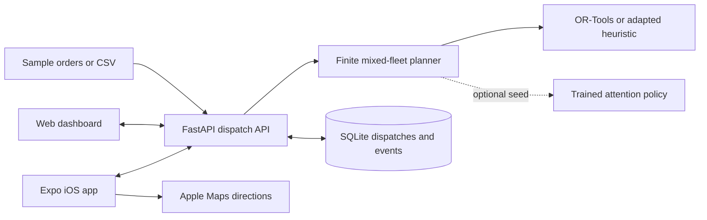

# Parcel

**A calmer way to plan, dispatch, and deliver the last mile.**

[](https://github.com/Mhokesh/Parcel/actions/workflows/checks.yml)
[](https://www.python.org/)
[](https://docs.expo.dev/versions/v57.0.0/)

A light, iOS-inspired dispatcher for Coimbatore delivery operations, with a FastAPI backend, browser dashboard and native Expo Go app. The research modules include an attention policy, REINFORCE training and classical CVRP baselines.

Parcel connects order intake, mixed-fleet route planning, driver itineraries, and delivery updates in one shared workspace. Its interface combines warm white surfaces, sage and peach accents, serif headings, and native iPhone controls.

**Status:** working local pilot. The application has been launched successfully on a physical iPhone with Expo Go. Automated validation covers API behaviour, routing invariants, dashboard workflows, and iOS bundle generation. Public deployment still needs the release work listed below.

## Architecture



## What works

- Load all 50 sample customer orders, search parcels, or validate and import a CSV.
- Plan with a **finite mixed fleet**: 15 kg bikes, 60 kg petrol vans, 80 kg diesel vans. One departure per vehicle; no implicit reloads or extra vehicles.
- Compare OR-Tools, savings-seeded insertion, nearest-neighbour adaptation and optional neural-seeded insertion. The operational planner always enforces the selected fleet.
- See estimated distance, load-dependent fuel, emissions and cost. Edit petrol and diesel rates per dispatch.
- Select routes on a map; open road directions in Apple Maps on iOS or Google Maps on the web.
- Mark the next delivery complete, defer it once for retry, or mark it failed for return. Failed cargo remains onboard. Retries begin from the current stop and revise remaining arrival estimates.
- Persist dispatches and progress in SQLite. Delivery events are deduplicated and stale concurrent updates return a refresh conflict.
- Reopen a saved dispatch from either client. Clients show network errors and never substitute canned route results.

## Start on Windows

Requires Git, Python 3.12, and Node.js 22.13 or later. Node 24 is supported. Use the committed lockfiles to install compatible dependencies.

First-time setup:

```powershell
git clone https://github.com/Mhokesh/Parcel.git
cd Parcel
python -m venv .venv
.\.venv\Scripts\python.exe -m pip install -r requirements-dev.txt
cd mobile-app
npm.cmd ci
cd ..
```

Start both services, with the Expo QR code in your terminal:

```powershell
.\scripts\start-dev.ps1
```

If PowerShell prevents running local scripts, start the services in two terminals instead:

```powershell
# Terminal 1, project root
.\.venv\Scripts\python.exe run_dashboard.py --host 0.0.0.0 --port 8000
```

```powershell
# Terminal 2
cd mobile-app
npm.cmd start
```

Browser dashboard: **http://127.0.0.1:8000**. API documentation in development: **http://127.0.0.1:8000/docs**.

### macOS / Linux

```bash
git clone https://github.com/Mhokesh/Parcel.git
cd Parcel
python3.12 -m venv .venv
source .venv/bin/activate
pip install -r requirements-dev.txt
python run_dashboard.py --host 0.0.0.0 --port 8000
```

In a second terminal, run `cd Parcel/mobile-app`, `npm ci`, and `npm start`. Keep the backend running while using either client.

## Test on your iPhone

1. Install/update **Expo Go** from the App Store. This app uses **Expo SDK 57**, matching the current App Store client. SDK 58's Expo Go store rollout is pending as of 20 October 2026; see [Expo's release notes](https://expo.dev/changelog/sdk-58).
2. Connect your computer and iPhone to the same Wi-Fi network.
3. Keep both services above running. Scan the Expo QR code with the iPhone Camera and open Expo Go.
4. Allow local-network access when requested. Parcel normally discovers the computer serving the Expo bundle.
5. If it cannot connect, open **Settings** inside Parcel and enter `http://YOUR_COMPUTER_LAN_IP:8000`. Use the computer’s IP, not `127.0.0.1` or `localhost`.
6. Review **Orders**, open **Plan**, choose fleet counts, then **Create dispatch plan**. Select a route and test delivery/retry actions.

The checked-in Expo configuration links this repository to [@mhokesh/or](https://expo.dev/@mhokesh/or), project ID `77c38a09-f341-45f5-90d3-3e1665d208ed`. This identifier is public configuration, not an access token. For the owner's workspace, log in to the same Expo account in the CLI (`npx expo login`) and Expo Go. When adapting a fork to another account, create your own Expo project and replace `expo.owner`, `expo.slug`, and `expo.extra.eas.projectId` in `mobile-app/app.json`.

Allow Python and Node through Windows Firewall on your trusted private network if Windows prompts. Check `http://YOUR_COMPUTER_LAN_IP:8000/api/health` in iPhone Safari to distinguish API connectivity from Expo connectivity.

`npm.cmd run start:tunnel` can tunnel the Expo bundle, but **does not tunnel the Python API**. For remote testing, host the API separately with HTTPS and enter its address in the app. `EXPO_PUBLIC_API_URL` is an optional mobile environment override; see `mobile-app/.env.example`. Access keys are entered inside Settings and stored in iOS Keychain, not in a public Expo environment variable.

The start scripts write Expo event logs to the system temporary directory rather than `.expo/dev/logs` inside OneDrive. This avoids a recalled OneDrive log placeholder crashing the dev server. If you change Wi-Fi networks, restart Expo and scan the newly printed QR code because the computer's LAN address may change.

## Planning semantics

OR-Tools is the default operational engine. It uses vehicle-specific capacities and fuel-sensitive arc costs with a two-second search budget. Order capacity and unique assignment are hard constraints. Delivery windows are soft targets; lateness is visible. Insufficient fleet capacity produces a **partial dispatch with explicit unassigned parcels**, not an invented extra truck.

Savings and neural policies originally construct homogeneous routes. The operational service uses their customer ordering as a seed for capacity-constrained insertion into the actual heterogeneous fleet. These adapted plans should not be presented as pure neural outputs. A time-limited OR-Tools solution is a feasible heuristic result, not a certified optimum.

The default data source is `data/sample_50_orders.csv`, including all 50 customer rows and depot metadata. The older 15-hub research case remains in `real_world/coimbatore_data.py` for CLI experiments.

CSV required columns: `id,name,lat,lon,weight_kg` (or `demand`). The first row must be depot ID `0`, with demand `0`. Customer IDs must be unique and weights positive. Optional columns: `customer_name,address,phone,product,size,ready_min,due_min,service_min`. Time windows are minutes from an **08:00 shift start**. Up to 200 customers and 500 KB per CSV. IDs may be nonconsecutive.

## Estimates and limitations

- Fuel uses a **linear load-dependent surrogate**, not a calibrated full CMEM implementation. Petrol/diesel prices are user-entered assumptions, not a live scraper. Arrival estimates use 30 km/h and service times, with no live traffic.
- Default distances use great-circle distance × 1.28. Set `OSRM_BASE_URL` to a routing service supporting the OSRM table API to use road distances; unavailable or invalid results fall back to clearly labelled estimates.
- Map polylines illustrate the stop sequence; they are not road geometry. Real directions open in a maps application. There is no background GPS tracking, push dispatch or offline event queue.
- The pilot web map uses OpenStreetMap standard tiles with visible attribution and normal browser caching. Configure a supported tile provider for a larger deployment; community tiles have no SLA. See the [OSMF tile policy](https://operations.osmfoundation.org/policies/tiles/).
- Dispatch metrics describe the original plan. Delivery state includes remaining payload, current stop and revised remaining ETAs. Failed parcels remain in the vehicle for return; depot handover is an operational step outside the current API.
- The original latency and “1.2% optimality gap” numbers have not been reproduced. They are **not release claims**. The original proposal is preserved in `docs/research-outline-original.md` as historical, unverified material.

## Neural research and training

Training dependencies are separate so the operational server can run without PyTorch:

```powershell
.\.venv\Scripts\python.exe -m pip install -r requirements-training.txt
.\.venv\Scripts\python.exe train.py --epochs 20 --batches 30 --batch_size 64 --num_customers 20 --capacity 30 --fuel_type diesel --save_path saved_checkpoints/custom_cvrp.pt
```

Set `NEURAL_CHECKPOINT_PATH` on the backend to select a custom checkpoint. **Legacy pretrained weights are not included in this repository**; see [saved_checkpoints/README.md](saved_checkpoints/README.md). Train a checkpoint or provide one you have evaluated. If OneDrive marks a checkpoint offline, choose **Always keep on this device**. Missing/offline checkpoints produce a clear unavailable error; untrained random weights are never served as a trained policy.

Training currently optimizes distance and fuel/CO₂ on synthetic coordinates. It does **not** train time windows or heterogeneous vehicle assignment. New training uses actual route payload before delivery, capacity-based mass conversion and a two-objective preference distribution. Legacy local checkpoints predate these corrections and require retraining and benchmarking before operational claims can be made.

```powershell
.\.venv\Scripts\python.exe evaluate.py --dataset coimbatore --algorithm all --fuel_type diesel --output artifacts/benchmark.json
```

The CLI evaluates homogeneous research instances; the operational API separately enforces the selected mixed fleet. Keep those comparisons distinct.

## Validation

```powershell
.\.venv\Scripts\python.exe -X pycache_prefix=runtime/pycache -m pytest tests -q
cd mobile-app
npm.cmd run check
npm.cmd run export:ios
```

For dashboard interaction and visual checks, while the API is running:

```powershell
npm.cmd install --prefix artifacts/browser-test playwright
node artifacts/browser-test/node_modules/playwright/cli.js install chromium
node tests/browser-smoke.cjs
```

Screenshots are written to `artifacts/`. The API/research suite has 22 passing checks when optional PyTorch dependencies are installed; neural-only checks skip when PyTorch is absent. GitHub Actions runs API checks and an iOS bundle export on pushes and pull requests. Physical iPhone launch has been verified; complete end-to-end field acceptance is still required before a public release.

## Deployment foundation

`requirements.txt` locks backend dependencies, generated from `requirements.in`. SQLite state is under `runtime/` by default; use a persistent volume and backup it. Paths resolve from the project, not the caller’s working directory. Launchers use `runtime/pycache` to avoid stale OneDrive bytecode placeholders.

Environment variables are read from the process; `.env.example` is documentation and is **not automatically loaded**:

| Variable | Purpose |
| --- | --- |
| `APP_ENV=production` | Requires an access key and disables interactive API docs |
| `DISPATCH_API_KEY` | Shared server access key, minimum 24 characters in production |
| `DISPATCH_DB_PATH` | SQLite file path on persistent storage |
| `CORS_ORIGINS` | Comma-separated browser origins allowed to call the API |
| `OSRM_BASE_URL` | Optional OSRM road-distance service |
| `MAP_TILE_URL`, `MAP_ATTRIBUTION` | Web map tile provider template and licence attribution |
| `NEURAL_CHECKPOINT_PATH` | Optional locally available trained weights |

```powershell
docker build -t parcel .
docker run --rm -p 8000:8000 --env-file .env -v parcel-data:/app/runtime parcel
```

Use HTTPS in front of the server. Health: `/api/health`. Solves run outside the async event loop, with bounded concurrent planning. Requests are bounded to 600 KB; schemas reject unsupported algorithms, invalid coordinates, negative capacities and nonfinite numbers. Logs contain request metadata, not parcel contents.

This is a substantially improved **local pilot foundation**, not a claim of public production certification. Before a public rollout: replace the shared access key with per-user/per-driver roles, configure a supported road-routing service, define retention and backup recovery, load-test target fleet sizes, validate measured fuel assumptions, resolve upstream Expo dependency advisories, and complete physical-device acceptance testing. See `docs/implementation-review.md`.

## Troubleshooting

| Symptom | Check |
| --- | --- |
| Expo Go reports an SDK mismatch | Use the project's SDK 57-compatible client. A newer SDK on npm may reach the App Store later. |
| iPhone stays on the loading screen | Keep Expo running, allow local-network access, confirm the same Wi-Fi, and scan the current QR after a network change. |
| App opens but cannot load orders | Open `http://YOUR_COMPUTER_LAN_IP:8000/api/health` in iPhone Safari, then check Parcel's server address in Settings. |
| Expo crashes writing a log | Use `npm start`, which redirects Expo event logs outside OneDrive. |
| Neural engine is unavailable | Install training dependencies and provide a readable trained checkpoint. OR-Tools works independently. |
| Some orders are unassigned | Add enough vehicles with suitable parcel capacities, then create another dispatch. |
| A delivery action reports a conflict | Refresh the dispatch; another device or a previous request has already changed its version. |

## Repository contents and attribution

Source code, sample data, configuration templates, tests, and setup documentation belong in the repository. Virtual environments, `node_modules`, Expo sessions, local credentials, dispatch databases, logs, and generated test artifacts are excluded. Keep customer uploads and operational data out of version control.

The mobile scaffold's Expo MIT notice is preserved in [mobile-app/LICENSE](mobile-app/LICENSE). The repository does not currently declare a separate project-wide license. The routing research is informed by attention-based routing policies, Clarke-Wright savings, and Google OR-Tools; see the historical research outline for background, with its performance claims treated as unverified.

## Directory map

| Directory | Responsibility |
| --- | --- |
| `web/app.py`, `schemas.py`, `planner.py`, `store.py` | API, validated contracts, finite mixed-fleet planning, persistence |
| `web/static/` | Responsive light dashboard, maps, CSV, delivery actions |
| `mobile-app/` | Native Expo Go client, iOS maps, secure key storage, file picking |
| `models/`, `rl/` | Attention policy, capacity masking, training and fuel objectives |
| `baselines/` | Homogeneous OR-Tools, Clarke–Wright and nearest-neighbour research solvers |
| `data/`, `real_world/` | Orders, synthetic/benchmark loaders, legacy hub data and geometry utility |
| `evaluation/` | Comparison metrics and Pareto analysis |
| `tests/`, `scripts/`, `docs/` | Integration/browser checks, local startup, implementation review |
